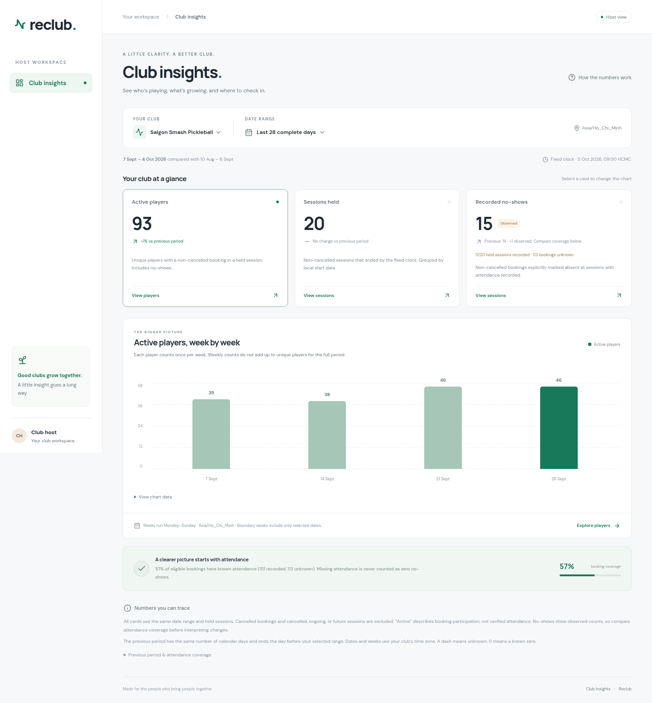

# Club Insights

Dashboard cho club host theo dõi active players, sessions đã diễn ra và no-shows, so sánh với kỳ trước, xem biểu đồ theo tuần và mở chi tiết phía sau mỗi chỉ số.



[Mobile preview](docs/screenshots/mobile.png) · [Club chưa có dữ liệu](docs/screenshots/empty-club.png) · [Đề bài](docs/assignment.pdf)

## Công nghệ sử dụng

| Công nghệ                          | Vai trò trong project                                                                                |
| ---------------------------------- | ---------------------------------------------------------------------------------------------------- |
| Node.js 26.13.1 LTS                | Runtime chạy ứng dụng, seed script và tests; cung cấp module `node:sqlite` để làm việc với SQLite    |
| Next.js 16 App Router              | Tổ chức trang, layout và JSON API bằng route handlers trong cùng project                             |
| React 19 + TypeScript              | Xây dựng giao diện, quản lý trạng thái bộ lọc bằng React hooks và định nghĩa kiểu dữ liệu dùng chung |
| SQLite                             | Lưu clubs, players, sessions, bookings và thông tin nguồn dữ liệu trong một file database            |
| Zod + csv-parse                    | Kiểm tra tham số API, xác thực dữ liệu CSV và đọc CSV có header                                      |
| CSS + Lucide React                 | Responsive layout, biểu đồ cột và icons; biểu đồ có bảng số liệu đi kèm                              |
| Node test runner + Playwright      | Kiểm thử hàm tính metrics, seed database, API và thao tác trên trình duyệt                           |
| ESLint + Prettier + GitHub Actions | Kiểm tra code, thống nhất format và chạy CI khi push hoặc mở pull request                            |

## Cài đặt và chạy

Cần Node.js **26.13.1** và npm. Nếu dùng nvm:

```sh
nvm install
nvm use
npm ci
npm run dev
```

Mở http://localhost:3000. Sau khi cài dependencies, chỉ cần **`npm run dev`**: script tự seed nếu database chưa có dữ liệu rồi khởi động Next.js. Database đã có dữ liệu được giữ nguyên.

Chạy bản production:

```sh
npm run build
npm start
```

## Cấu trúc project

```text
src/
  app/
    layout.tsx              # Layout gốc, metadata và global CSS
    page.tsx                # Trang chính, render Dashboard
    api/
      clubs/route.ts        # GET /api/clubs: danh sách club
      insights/route.ts     # GET /api/insights: metrics, chart và chi tiết
  components/
    dashboard.tsx           # Gọi API, quản lý bộ lọc và ghép các phần giao diện
    metric-card.tsx         # Card chỉ số, định nghĩa và so sánh kỳ trước
    weekly-chart.tsx        # Biểu đồ theo tuần và bảng dữ liệu
    detail-dialog.tsx       # Dialog hiển thị players hoặc sessions của chỉ số
  lib/
    types.ts                # Các kiểu Club, Session, Booking, Insights...
    db.ts                   # Schema SQLite và các truy vấn đọc dữ liệu
    metrics.ts              # Hàm thuần tính summary, weekly metrics và drill-down
    dates.ts                # Clock cố định, ngày địa phương và phép tính tuần/kỳ
    http.ts                 # Validation tham số và response JSON
scripts/
  seed.ts                   # Đọc, validate và import bốn CSV trong một transaction
data/csv/                  # clubs.csv, players.csv, sessions.csv, bookings.csv
tests/
  assessment-data.test.ts   # Đối chiếu số liệu đã audit từ CSV gốc
  metrics.test.ts           # No-show unknown/zero, biên ngày, tuần, unique players
  seed.test.ts              # Seed lặp lại và rollback khi import lỗi
  http.test.ts              # Validation khoảng ngày của API
  e2e/dashboard.spec.ts     # API thực tế, desktop/mobile, filters và retry
docs/                      # API contract, CSV contract, checklist và ảnh preview
.github/workflows/ci.yml    # Cài dependencies, check, build và browser tests
```

## Luồng dữ liệu

1. `scripts/seed.ts` đọc bốn CSV, validate bằng Zod và ghi vào SQLite. Import lỗi sẽ rollback toàn bộ, giữ dữ liệu cũ.
2. `dashboard.tsx` gọi `/api/clubs` để lấy club switcher, sau đó gọi `/api/insights` với `clubId`, `start`, `end`.
3. Route handler kiểm tra tham số qua `http.ts`, đọc dữ liệu qua `db.ts` và gọi `calculateInsights()` trong `metrics.ts`.
4. API trả JSON gồm kỳ hiện tại, kỳ trước, dữ liệu tuần và danh sách players/sessions để truy ngược chỉ số. Cùng API này có thể dùng cho mobile app.
5. React hiển thị metric cards, chart và detail dialog. Đổi club hoặc áp dụng khoảng ngày sẽ gọi lại API; chọn card đổi metric đang xem trên chart.

Frontend lấy dữ liệu qua JSON API; các truy vấn database nằm phía server. Chi tiết response nằm trong [API contract](docs/api.md).

## Dữ liệu và seed

`data/csv/` chứa nguyên bốn CSV được cung cấp cùng bài: **2 clubs, 260 players, 195 sessions và 1.893 bookings**. Saigon Smash Pickleball có dữ liệu từ tháng 1 đến tháng 10/2026; Thảo Điền Tennis Club được tạo ngày 1/10/2026 và chưa có session. Xem [CSV contract](docs/csv-contract.md) để biết cách ánh xạ các cột vào database.

```sh
npm run seed                              # Seed lại database từ CSV đi kèm
npm run seed -- --csv-dir /path/to/csvs    # Import thư mục có đủ bốn CSV
```

Database demo từ phiên bản cũ được tự thay bằng CSV gốc khi khởi động. Với database đã import, `npm run dev` giữ nguyên dữ liệu; dùng `npm run seed` khi muốn nạp lại.

Database mặc định là `data/club-insights.sqlite`, không được commit vào Git. Có thể đổi vị trí qua biến `DATABASE_PATH`; mặc định không cần tạo file môi trường.

## Quy tắc tính chỉ số

- **Clock:** cố định ở `2026-10-05T02:00:00Z`, tương ứng 09:00 ngày 5/10/2026 tại TP.HCM.
- **Sessions held:** session chưa hủy, đã kết thúc trước hoặc đúng clock; thuộc ngày bắt đầu theo timezone của club.
- **Active players:** số player duy nhất có booking chưa hủy trong các held sessions, bao gồm no-shows và attendance chưa biết.
- **Recorded no-shows:** booking chưa hủy được ghi rõ absent ở session đã ghi attendance. Dữ liệu chưa ghi nhận là unknown; API trả `null` nếu hoàn toàn chưa biết, không thay bằng 0. UI hiển thị độ phủ attendance.
- **So sánh:** kỳ trước có cùng số ngày, kết thúc ngay trước ngày bắt đầu của kỳ được chọn. Mặc định chọn 28 ngày hoàn chỉnh gần nhất theo clock.
- **Tuần:** thứ Hai–Chủ nhật theo timezone club. Tuần đầu/cuối chỉ tính ngày trong bộ lọc và có nhãn partial. Weekly unique players không cộng thành unique players toàn kỳ.

## Kiểm tra code

```sh
npm run check           # Prettier, ESLint, TypeScript và unit/integration tests
npm run build           # Build production
npx playwright install chromium
npm run test:e2e        # API và browser tests; tự khởi động app nếu cần
npm run format          # Format code bằng Prettier
```

Nếu dùng Chromium đã cài trên máy: `PLAYWRIGHT_CHROMIUM_EXECUTABLE_PATH=/usr/bin/chromium npm run test:e2e`. Browser tests dùng CSV gốc trong repo. CI chạy trên cùng phiên bản Node khai báo trong `.nvmrc`.

Đối chiếu yêu cầu đề bài tại [spec checklist](docs/spec-checklist.md).
